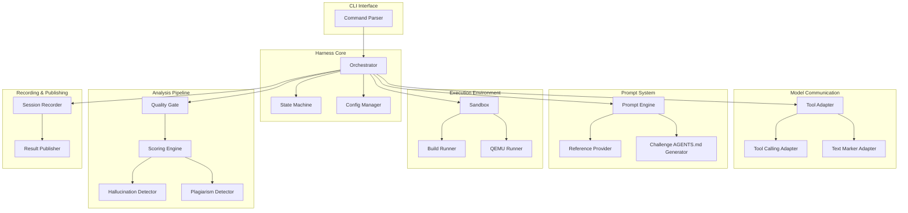
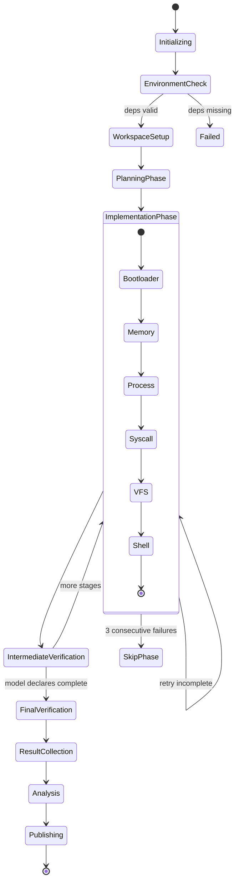

# Design Document: Hallucination Benchmark

## Overview

The Hallucination Benchmark is a CLI-based test harness that orchestrates LLM API interactions to measure coding hallucinations. It assigns models the task of implementing a POSIX-compliant operating system for i686 (x86 32-bit) and systematically evaluates the quality, correctness, and originality of the generated code.

The system is implemented in **TypeScript** running on **Node.js** (v20+), chosen for:
- Native async/await for API orchestration
- Strong typing for complex data models
- Rich ecosystem for CLI tooling (commander, inquirer)
- JSON-native for structured data handling
- Easy integration with GitHub Actions for CI/CD

### High-Level Architecture



### Technology Stack

| Component | Technology | Rationale |
|-----------|-----------|-----------|
| Runtime | Node.js 20+ | LTS, native fetch, stable async |
| Language | TypeScript 5.x | Type safety for complex data models |
| CLI Framework | Commander.js | Lightweight, well-documented |
| HTTP Client | Native fetch + retry wrapper | No extra dependencies |
| Build Tool | tsx + tsup | Fast dev iteration + bundling |
| Test Framework | Vitest | Fast, TypeScript-native, PBT via fast-check |
| PBT Library | fast-check | Mature, TypeScript-first PBT |
| Schema Validation | Zod | Runtime validation + type inference |
| Template Engine | Handlebars | Logic-less templates for prompts |
| Static Site | Eleventy (11ty) | Simple, markdown-native static site gen |
| Process Execution | execa | Better child process management |

## Architecture

### System Context

The harness operates as a standalone CLI application that:
1. Reads configuration (model API settings, challenge parameters)
2. Initializes a sandboxed workspace with skeleton code
3. Orchestrates a multi-stage conversation with the target LLM
4. Records all interactions and file changes
5. Runs quality gates (build, boot, tests) against generated code
6. Analyzes outputs for hallucinations and plagiarism
7. Computes scores and publishes results

### State Machine

The test workflow follows a deterministic state machine:



### Checkpoint and Resume

Each state transition is persisted to a checkpoint file (`session-checkpoint.json`) in the results directory. On resume, the harness reads the last completed state and resumes from the next state.

## Components and Interfaces

### 1. CLI Interface (`cli/`)

Entry point for all user interactions.

```typescript
interface CLICommands {
  run(options: RunOptions): Promise<void>;
  resume(sessionId: string): Promise<void>;
  results(options: ResultQueryOptions): Promise<void>;
  report(options: ReportOptions): Promise<void>;
  validate(configPath: string): Promise<void>;
}

interface RunOptions {
  config: string;        // Path to model config file
  provider: string;      // e.g., "anthropic", "openai"
  model: string;         // e.g., "claude-sonnet-4-5"
  outputDir?: string;    // Override default results path
  verbose?: boolean;
}

interface ResultQueryOptions {
  provider?: string;
  model?: string;
  format: 'table' | 'json' | 'markdown';
}
```

### 2. Orchestrator (`core/orchestrator.ts`)

Central coordinator that drives the state machine and delegates to subsystems.

```typescript
interface Orchestrator {
  initialize(config: SessionConfig): Promise<Session>;
  run(session: Session): Promise<SessionResult>;
  resume(sessionId: string): Promise<SessionResult>;
  abort(sessionId: string): Promise<void>;
}

interface Session {
  id: string;
  config: SessionConfig;
  state: WorkflowState;
  startedAt: Date;
  checkpoints: Checkpoint[];
}
```

### 3. Tool Adapter (`adapters/tool-adapter.ts`)

Abstracts model communication, supporting both tool-calling and text-marker modes.

```typescript
interface ToolAdapter {
  sendMessage(messages: Message[], tools?: ToolDefinition[]): Promise<ModelResponse>;
  getMode(): 'tool-calling' | 'text-marker';
}

interface ToolCallingAdapter extends ToolAdapter {
  // Uses native function calling protocol
  sendMessage(messages: Message[], tools: ToolDefinition[]): Promise<ToolCallingResponse>;
}

interface TextMarkerAdapter extends ToolAdapter {
  // Parses <<<FILE: path>>> markers from text
  sendMessage(messages: Message[]): Promise<TextMarkerResponse>;
  parseFileMarkers(text: string): FileOperation[];
}

interface ModelResponse {
  content: string;
  toolCalls?: ToolCall[];
  fileOperations?: FileOperation[];
  usage: TokenUsage;
  rawResponse: unknown;
}

interface ToolCall {
  id: string;
  name: string;
  arguments: Record<string, unknown>;
}

interface FileOperation {
  type: 'create' | 'modify' | 'delete';
  path: string;
  content?: string;
}

interface TokenUsage {
  inputTokens: number;
  outputTokens: number;
  totalTokens: number;
}
```

### 4. Prompt Engine (`prompt/prompt-engine.ts`)

Generates and manages prompts for each workflow stage.

```typescript
interface PromptEngine {
  generatePlanningPrompt(context: ChallengeContext): Message[];
  generateStagePrompt(stage: ImplementationStage, context: StageContext): Message[];
  generateFollowUpPrompt(issues: CodeIssue[]): Message[];
  generateVerificationPrompt(stage: ImplementationStage): Message[];
  detectIncompletePatterns(code: string): IncompletePattern[];
}

interface ChallengeContext {
  agentsMd: string;
  skeletonFiles: FileEntry[];
  references: ReferenceDocument[];
}

interface IncompletePattern {
  type: 'todo' | 'stub' | 'placeholder' | 'empty-body';
  location: FileLocation;
  snippet: string;
}
```

### 5. Reference Provider (`prompt/reference-provider.ts`)

Supplies POSIX spec references without implementation code.

```typescript
interface ReferenceProvider {
  getReferencesForStage(stage: ImplementationStage): ReferenceDocument[];
  searchReferences(query: string): ReferenceSearchResult[];
  loadReferenceLibrary(path: string): void;
}

interface ReferenceDocument {
  id: string;
  title: string;
  section: string;
  content: string;  // Spec text only, no implementation
  source: 'posix' | 'intel-manual' | 'multiboot';
}
```

### 6. Sandbox (`sandbox/sandbox.ts`)

Provides file system isolation for model operations.

```typescript
interface Sandbox {
  initialize(workspacePath: string): Promise<void>;
  readFile(path: string): Promise<string>;
  writeFile(path: string, content: string): Promise<void>;
  deleteFile(path: string): Promise<void>;
  listDirectory(path: string): Promise<DirectoryEntry[]>;
  createDirectory(path: string): Promise<void>;
  executeCommand(command: string, args: string[]): Promise<CommandResult>;
  resolvePath(requestedPath: string): string;  // Throws on traversal
  getViolationLog(): SandboxViolation[];
}

interface SandboxViolation {
  timestamp: Date;
  requestedPath: string;
  operation: 'read' | 'write' | 'delete' | 'list' | 'exec';
  blocked: boolean;
}

interface CommandResult {
  exitCode: number;
  stdout: string;
  stderr: string;
  durationMs: number;
}
```

### 7. Quality Gate (`analysis/quality-gate.ts`)

Sequential verification pipeline.

```typescript
interface QualityGate {
  runSyntaxCheck(workspace: string): Promise<GateResult>;
  runBuildCheck(workspace: string): Promise<BuildGateResult>;
  runBootCheck(workspace: string, kernelImage: string): Promise<BootGateResult>;
  runTestSuite(workspace: string): Promise<TestGateResult>;
  runFullPipeline(workspace: string): Promise<QualityGateReport>;
}

interface GateResult {
  stage: 'syntax' | 'build' | 'boot' | 'test';
  passed: boolean;
  details: string;
  logs: string[];
  durationMs: number;
}

interface BuildGateResult extends GateResult {
  warningCount: number;
  errorCount: number;
  binaryPath?: string;
  binarySize?: number;
}

interface BootGateResult extends GateResult {
  serialOutput: string;
  bootTimeMs: number;
  reachedSerialOutput: boolean;
}

interface TestGateResult extends GateResult {
  totalTests: number;
  passed: number;
  failed: number;
  skipped: number;
  phaseResults: Map<Phase, PhaseTestResult>;
}
```

### 8. Scoring Engine (`analysis/scoring-engine.ts`)

Computes weighted scores across all categories.

```typescript
interface ScoringEngine {
  computeScore(input: ScoringInput): ScoringResult;
  computeBuildScore(buildResult: BuildGateResult): CategoryScore;
  computeBootScore(bootResult: BootGateResult): CategoryScore;
  computeFunctionalityScore(testResult: TestGateResult): CategoryScore;
  computeConsistencyScore(consistencyData: ConsistencyData): CategoryScore;
  computeOriginalityScore(plagiarismResult: PlagiarismReport): CategoryScore;
}

interface ScoringInput {
  buildResult: BuildGateResult;
  bootResult: BootGateResult;
  testResult: TestGateResult;
  consistencyData: ConsistencyData;
  plagiarismReport: PlagiarismReport;
}

interface CategoryScore {
  category: ScoreCategory;
  rawScore: number;       // 0-100
  weight: number;         // Category weight
  weightedScore: number;  // rawScore * weight
  breakdown: ScoreBreakdown[];
}

interface ScoringResult {
  finalScore: number;     // 0-100 weighted sum
  categories: CategoryScore[];
  phaseScores: Map<Phase, number>;
  timestamp: Date;
}

type ScoreCategory = 'build' | 'boot' | 'functionality' | 'consistency' | 'originality';
```

### 9. Hallucination Detector (`analysis/hallucination-detector.ts`)

Identifies and classifies hallucination patterns.

```typescript
interface HallucinationDetector {
  analyze(session: SessionRecord): Promise<HallucinationReport>;
  detectNonExistentAPIs(code: string, references: ReferenceDocument[]): HallucinationInstance[];
  detectIncorrectSyscallNumbers(code: string): HallucinationInstance[];
  detectFictitiousRegisters(code: string): HallucinationInstance[];
  detectLogicalInconsistencies(code: string): HallucinationInstance[];
  detectSelfContradictions(history: FileChangeHistory[]): HallucinationInstance[];
  detectCoTErrors(cot: string[], code: string): HallucinationInstance[];
}

interface HallucinationInstance {
  id: string;
  type: HallucinationType;
  severity: 'critical' | 'major' | 'minor';
  location: FileLocation;
  description: string;
  evidence: string;
  confidence: number;  // 0-1
}

type HallucinationType =
  | 'non-existent-api'
  | 'incorrect-syscall-number'
  | 'fictitious-register'
  | 'logical-inconsistency'
  | 'self-contradiction'
  | 'cot-error';
```

### 10. Plagiarism Detector (`analysis/plagiarism-detector.ts`)

Compares output against known OS codebases.

```typescript
interface PlagiarismDetector {
  analyze(files: FileEntry[]): Promise<PlagiarismReport>;
  compareAgainstCorpus(code: string, corpus: CodeCorpus): SimilarityMatch[];
  loadCorpus(name: string): CodeCorpus;
}

interface SimilarityMatch {
  sourceFile: string;
  targetFile: string;
  sourceProject: 'xv6' | 'linux' | 'minix' | 'other';
  startLine: number;
  endLine: number;
  lineCount: number;
  similarity: number;  // 0-1
  flagged: boolean;    // true if >= 50 lines && >= 70% similarity
}

interface PlagiarismReport {
  totalFilesAnalyzed: number;
  totalLinesAnalyzed: number;
  flaggedBlocks: SimilarityMatch[];
  overallSimilarityRatio: number;
  byProject: Map<string, number>;
}
```

### 11. Session Recorder (`recording/session-recorder.ts`)

Records all interactions and file changes.

```typescript
interface SessionRecorder {
  startSession(config: SessionConfig): string;
  recordMessage(sessionId: string, message: Message, direction: 'sent' | 'received'): void;
  recordFileChange(sessionId: string, change: FileChange): void;
  recordToolCall(sessionId: string, call: ToolCallRecord): void;
  recordGateResult(sessionId: string, result: GateResult): void;
  recordCheckpoint(sessionId: string, state: WorkflowState): void;
  getSessionRecord(sessionId: string): SessionRecord;
  finalizeSession(sessionId: string): SessionRecord;
}

interface FileChange {
  timestamp: Date;
  operation: 'create' | 'modify' | 'delete';
  path: string;
  contentBefore?: string;
  contentAfter?: string;
  diff?: string;
}

interface ToolCallRecord {
  timestamp: Date;
  toolName: string;
  arguments: Record<string, unknown>;
  result: unknown;
  durationMs: number;
  permitted: boolean;
}
```

### 12. Result Publisher (`publishing/result-publisher.ts`)

Generates reports and static site.

```typescript
interface ResultPublisher {
  generateModelReport(sessionRecord: SessionRecord, scoringResult: ScoringResult): ModelReport;
  generateComparisonTable(reports: ModelReport[]): ComparisonTable;
  generateStaticSite(outputDir: string): Promise<void>;
  updateRankings(newReport: ModelReport): Promise<void>;
}

interface ModelReport {
  provider: string;
  model: string;
  sessionId: string;
  timestamp: Date;
  finalScore: number;
  categoryScores: CategoryScore[];
  hallucinationSummary: HallucinationSummary;
  plagiarismSummary: PlagiarismSummary;
  highlightHallucinations: HallucinationInstance[];  // Top 5
  sessionDuration: number;
  totalTokensUsed: number;
}

interface ComparisonTable {
  models: ModelComparisonRow[];
  lastUpdated: Date;
}

interface ModelComparisonRow {
  provider: string;
  model: string;
  finalScore: number;
  buildScore: number;
  bootScore: number;
  functionalityScore: number;
  consistencyScore: number;
  originalityScore: number;
  hallucinationFrequency: number;
  plagiarismRatio: number;
}
```

## Data Models

### Session Configuration

```typescript
interface SessionConfig {
  // Model settings
  provider: string;
  model: string;
  apiKey: string;
  apiEndpoint: string;
  toolCallingSupported: boolean;

  // Challenge settings
  challengeVersion: string;
  implementationLanguage: 'c' | 'c++';
  bootMethod: 'grub-multiboot' | 'custom';

  // Harness settings
  workspaceDir: string;
  resultsDir: string;
  referencesDir: string;
  skeletonDir: string;

  // Retry settings
  maxRetries: number;          // Default: 3
  retryBackoffMs: number;      // Default: 1000
  incompleteCodeMaxRetries: number;  // Default: 3

  // QEMU settings
  qemuBinary: string;         // Default: "qemu-system-i386"
  qemuTimeout: number;        // Boot timeout in ms
  serialCaptureTimeout: number;
}
```

### Session Record (Persisted)

```json
{
  "id": "session-uuid",
  "config": { /* SessionConfig minus apiKey */ },
  "state": "analysis",
  "startedAt": "2025-01-15T10:00:00Z",
  "completedAt": "2025-01-15T14:30:00Z",
  "messages": [
    {
      "timestamp": "2025-01-15T10:01:00Z",
      "role": "assistant",
      "content": "...",
      "toolCalls": [],
      "tokenUsage": { "input": 1500, "output": 3000 }
    }
  ],
  "fileChanges": [
    {
      "timestamp": "2025-01-15T10:02:00Z",
      "operation": "create",
      "path": "kernel/main.c",
      "contentAfter": "..."
    }
  ],
  "toolCalls": [
    {
      "timestamp": "2025-01-15T10:02:00Z",
      "toolName": "write_file",
      "arguments": { "path": "kernel/main.c", "content": "..." },
      "result": { "success": true },
      "durationMs": 5,
      "permitted": true
    }
  ],
  "checkpoints": [
    { "state": "planning", "timestamp": "2025-01-15T10:05:00Z" },
    { "state": "implementation:bootloader", "timestamp": "2025-01-15T10:30:00Z" }
  ],
  "gateResults": [],
  "modelDeclaredComplete": false,
  "totalTokensUsed": { "input": 150000, "output": 500000 }
}
```

### Scoring Result (Persisted)

```json
{
  "sessionId": "session-uuid",
  "timestamp": "2025-01-15T14:30:00Z",
  "finalScore": 42.5,
  "categories": [
    {
      "category": "build",
      "rawScore": 85,
      "weight": 0.20,
      "weightedScore": 17.0,
      "breakdown": [
        { "metric": "compilation_success", "value": true, "score": 50 },
        { "metric": "warning_count", "value": 12, "score": 20 },
        { "metric": "error_count", "value": 0, "score": 15 }
      ]
    },
    {
      "category": "boot",
      "rawScore": 60,
      "weight": 0.25,
      "weightedScore": 15.0,
      "breakdown": [
        { "metric": "qemu_boot", "value": true, "score": 40 },
        { "metric": "serial_output", "value": true, "score": 20 }
      ]
    },
    {
      "category": "functionality",
      "rawScore": 30,
      "weight": 0.30,
      "weightedScore": 9.0,
      "breakdown": [
        { "metric": "phase:bootloader", "value": 80, "score": 13 },
        { "metric": "phase:memory", "value": 40, "score": 7 },
        { "metric": "phase:process", "value": 20, "score": 3 },
        { "metric": "phase:syscall", "value": 10, "score": 3 },
        { "metric": "phase:vfs", "value": 5, "score": 2 },
        { "metric": "phase:shell", "value": 0, "score": 0 }
      ]
    },
    {
      "category": "consistency",
      "rawScore": 10,
      "weight": 0.15,
      "weightedScore": 1.5,
      "breakdown": [
        { "metric": "self_contradiction_ratio", "value": 0.15, "score": 5 },
        { "metric": "declared_unimplemented_ratio", "value": 0.30, "score": 5 }
      ]
    },
    {
      "category": "originality",
      "rawScore": 0,
      "weight": 0.10,
      "weightedScore": 0,
      "breakdown": [
        { "metric": "plagiarism_deduction", "value": 0.45, "score": 0 }
      ]
    }
  ],
  "phaseScores": {
    "bootloader": 80,
    "memory": 40,
    "process": 20,
    "syscall": 10,
    "vfs": 5,
    "shell": 0
  }
}
```

### Hallucination Report (Persisted)

```json
{
  "sessionId": "session-uuid",
  "timestamp": "2025-01-15T14:30:00Z",
  "totalInstances": 47,
  "bySeverity": { "critical": 8, "major": 22, "minor": 17 },
  "byType": {
    "non-existent-api": 12,
    "incorrect-syscall-number": 9,
    "fictitious-register": 5,
    "logical-inconsistency": 11,
    "self-contradiction": 7,
    "cot-error": 3
  },
  "instances": [
    {
      "id": "hall-001",
      "type": "incorrect-syscall-number",
      "severity": "critical",
      "location": { "file": "kernel/syscall.c", "line": 45, "column": 12 },
      "description": "Used syscall number 42 for fork(), correct POSIX number is 2",
      "evidence": "#define SYS_fork 42  // Incorrect: should be 2",
      "confidence": 0.95
    }
  ],
  "highlightCases": []
}
```

### Configuration File Schema

The user-facing configuration file (`config.yaml`):

```yaml
# Model API Configuration
provider: "anthropic"
model: "claude-sonnet-4-5"
api_key: "${ANTHROPIC_API_KEY}"  # Env var reference
api_endpoint: "https://api.anthropic.com/v1"
tool_calling: true

# Challenge Configuration (optional overrides)
challenge:
  version: "1.0"
  language: "c"           # "c" or "c++"
  boot_method: "grub-multiboot"  # "grub-multiboot" or "custom"

# Harness Configuration (optional overrides)
harness:
  max_retries: 3
  retry_backoff_ms: 1000
  qemu_timeout_ms: 30000
  serial_capture_timeout_ms: 10000
```

### Directory Structure

```
/
├── harness/
│   ├── src/
│   │   ├── cli/
│   │   │   └── index.ts              # CLI entry point
│   │   ├── core/
│   │   │   ├── orchestrator.ts        # Main workflow coordinator
│   │   │   ├── state-machine.ts       # Workflow state management
│   │   │   └── config-manager.ts      # Configuration loading/validation
│   │   ├── adapters/
│   │   │   ├── tool-adapter.ts        # Adapter interface
│   │   │   ├── tool-calling-adapter.ts
│   │   │   └── text-marker-adapter.ts
│   │   ├── prompt/
│   │   │   ├── prompt-engine.ts       # Prompt generation
│   │   │   ├── reference-provider.ts  # POSIX reference management
│   │   │   ├── agents-md-generator.ts # Challenge AGENTS.md creation
│   │   │   └── templates/             # Handlebars prompt templates
│   │   ├── sandbox/
│   │   │   └── sandbox.ts            # File system isolation
│   │   ├── analysis/
│   │   │   ├── quality-gate.ts       # Build/boot/test verification
│   │   │   ├── scoring-engine.ts     # Weighted score computation
│   │   │   ├── hallucination-detector.ts
│   │   │   └── plagiarism-detector.ts
│   │   ├── recording/
│   │   │   └── session-recorder.ts   # Interaction logging
│   │   ├── publishing/
│   │   │   ├── result-publisher.ts   # Report generation
│   │   │   ├── static-site/          # 11ty site templates
│   │   │   └── templates/            # Markdown report templates
│   │   └── types/
│   │       ├── index.ts              # Shared type definitions
│   │       ├── session.ts
│   │       ├── scoring.ts
│   │       └── hallucination.ts
│   ├── skeleton/                      # Skeleton code for model workspace
│   │   ├── Makefile
│   │   ├── linker.ld
│   │   └── boot/
│   │       └── boot.s                # Minimal boot stub
│   ├── references/                    # POSIX spec documents (no impl code)
│   │   ├── posix-syscalls.md
│   │   ├── posix-filesystem.md
│   │   ├── posix-process.md
│   │   ├── intel-i686.md
│   │   └── multiboot-spec.md
│   ├── corpus/                        # Plagiarism comparison corpus
│   │   ├── xv6-signatures.json
│   │   ├── linux-signatures.json
│   │   └── minix-signatures.json
│   ├── config.template.yaml           # Configuration template
│   ├── package.json
│   ├── tsconfig.json
│   └── vitest.config.ts
├── results/
│   └── {provider}/
│       └── {model-name}/
│           ├── session-record.json
│           ├── scoring-result.json
│           ├── hallucination-report.json
│           ├── plagiarism-report.json
│           ├── report.md
│           ├── session-checkpoint.json
│           └── workspace/             # Model's generated code
├── .kiro/
├── AGENTS.md
└── README.md
```

## Correctness Properties

*A property is a characteristic or behavior that should hold true across all valid executions of a system — essentially, a formal statement about what the system should do. Properties serve as the bridge between human-readable specifications and machine-verifiable correctness guarantees.*

### Property 1: Text marker parsing round-trip

*For any* valid file path (containing no newlines) and any file content string, wrapping them in `<<<FILE: {path}>>>\n{content}\n<<<END_FILE>>>` markers and parsing the result should extract the original path and content unchanged.

**Validates: Requirements 1.3**

### Property 2: Session recording completeness and ordering

*For any* sequence of recorded events (messages, file changes, tool calls) submitted to the Session_Recorder, the resulting session record should contain all events in chronological order with no data loss, and the count of each event type should match the number submitted.

**Validates: Requirements 1.4, 9.5**

### Property 3: Configuration serialization round-trip

*For any* valid SessionConfig object, serializing it to YAML and parsing it back should produce an equivalent configuration object with all fields preserved.

**Validates: Requirements 1.5**

### Property 4: Retry behavior correctness

*For any* sequence of API call attempts where the first N attempts fail (N in 0..10), the harness should succeed if N ≤ 3 (retry succeeds on attempt N+1) and record failure if N > 3 (all retries exhausted).

**Validates: Requirements 1.6**

### Property 5: Incomplete code pattern detection

*For any* code string containing one or more known incomplete patterns (TODO comments, empty function bodies, placeholder text), the detector should identify all injected patterns. For any code string without such patterns, the detector should return an empty result.

**Validates: Requirements 3.2**

### Property 6: Three-consecutive-failure area skip

*For any* sequence of model responses for a given implementation area, if exactly 3 consecutive responses are classified as incomplete, the engine should mark that area as "implementation failure" and advance to the next area. Fewer than 3 consecutive failures should not trigger a skip.

**Validates: Requirements 3.6**

### Property 7: Weighted score computation invariant

*For any* set of five category raw scores (each in 0–100), the final score should equal exactly: `build * 0.20 + boot * 0.25 + functionality * 0.30 + consistency * 0.15 + originality * 0.10`, and the result should always be in the range [0, 100].

**Validates: Requirements 4.4**

### Property 8: Build score monotonicity

*For any* two build results where result A has fewer errors and fewer warnings than result B (with same compilation success), the build score for A should be greater than or equal to the build score for B.

**Validates: Requirements 4.5**

### Property 9: Functionality score proportionality

*For any* test suite result, the functionality score should be proportional to the overall pass rate (passed / total tests), and should be 0 when no tests pass and 100 when all tests pass.

**Validates: Requirements 4.7**

### Property 10: Phase scoring independence

*For any* set of phase test results, changing the score of one phase to zero should not affect the scores of any other phase. Each phase's contribution to the functionality score depends only on its own test results.

**Validates: Requirements 4.8**

### Property 11: Consistency score inverse proportionality

*For any* self-contradiction ratio and declared-but-unimplemented ratio (each in [0, 1]), the consistency score should decrease as either ratio increases, and should be 100 when both ratios are 0.

**Validates: Requirements 4.9**

### Property 12: Originality score with plagiarism deductions

*For any* plagiarism proportion (in [0, 1]), the originality score should decrease as the proportion increases, should be 100 when proportion is 0, and should be 0 when proportion is 1.

**Validates: Requirements 4.10, 6.6**

### Property 13: Hallucination classification and severity completeness

*For any* detected hallucination instance, it must be assigned exactly one valid type from the defined set (non-existent-api, incorrect-syscall-number, fictitious-register, logical-inconsistency, self-contradiction, cot-error) AND exactly one valid severity level (critical, major, minor).

**Validates: Requirements 5.1, 5.2**

### Property 14: Self-contradiction detection across file versions

*For any* file change history where a later version redefines a constant, struct field, or function signature to a value contradicting an earlier version, the detector should flag at least one self-contradiction. For histories with no contradictions, the detector should return zero self-contradiction instances.

**Validates: Requirements 5.5**

### Property 15: Hallucination report serialization round-trip

*For any* valid HallucinationReport object, serializing to JSON and deserializing back should produce an equivalent object, and the JSON output should validate against the defined schema.

**Validates: Requirements 5.6**

### Property 16: Code similarity measurement validity

*For any* two code strings, the similarity score should be in the range [0, 1], should be 1.0 when the strings are identical, and should be 0.0 when the strings share no common subsequences.

**Validates: Requirements 6.4**

### Property 17: Plagiarism flagging threshold

*For any* similarity match result, it should be flagged as "suspected plagiarism" if and only if the contiguous block has 50 or more lines AND the similarity score is 0.70 or higher.

**Validates: Requirements 6.5**

### Property 18: Report generation completeness

*For any* valid scoring result and session data, the generated markdown report should contain all required sections (summary, per-category breakdown, phase scores, hallucination highlights) and the comparison table should include all required columns (final score, per-category scores, hallucination frequency, plagiarism ratio) for every model in the input set.

**Validates: Requirements 7.1, 7.2**

### Property 19: Incremental result update preservation

*For any* existing set of model reports and a new report being added, after updating, the comparison table should contain all previous entries unchanged plus the new entry. No existing data should be lost or modified.

**Validates: Requirements 7.5**

### Property 20: Top-5 hallucination highlight selection

*For any* set of hallucination instances (with varying confidence scores), the highlight section should contain exactly min(5, total_instances) entries, and they should be the instances with the highest confidence scores in descending order.

**Validates: Requirements 7.6**

### Property 21: Completion declaration detection

*For any* model response text, the harness should detect a completion declaration if and only if the text contains an explicit completion signal (as defined by the completion patterns). False positives (detecting completion in normal implementation responses) and false negatives (missing actual declarations) should not occur.

**Validates: Requirements 8.2**

### Property 22: Checkpoint and resume correctness

*For any* workflow state that is checkpointed, resuming from that checkpoint should place the state machine at the exact next state in the workflow sequence, with all prior state preserved.

**Validates: Requirements 8.4**

### Property 23: Multi-run result aggregation

*For any* set of N scoring results (N ≥ 1) for the same model, the aggregated result should have a mean final score equal to the arithmetic mean of individual final scores, and min/max values should correspond to actual extremes in the set.

**Validates: Requirements 8.5**

### Property 24: Tool permission enforcement

*For any* tool call request, if the tool name is in the permitted set, the call should be executed; if the tool name is NOT in the permitted set, the call should be rejected with a reason string that names the disallowed tool.

**Validates: Requirements 9.6**

### Property 25: Provider and model name validation

*For any* string, the path component validator should accept it if and only if it matches the pattern `^[a-z0-9]+(-[a-z0-9]+)*$` (lowercase alphanumeric with hyphens, no leading/trailing/consecutive hyphens). Valid names should produce correct result paths in the format `results/{provider}/{model-name}`.

**Validates: Requirements 10.2, 10.3**

### Property 26: API configuration validation with error reporting

*For any* configuration object missing one or more required fields (apiKey, apiEndpoint, provider, model), validation should reject the config AND the error message should name every missing field. For complete valid configs, validation should pass.

**Validates: Requirements 11.4, 11.5**

### Property 27: Sandbox path containment

*For any* requested file path (including paths with `../` traversal sequences, absolute paths, encoded sequences, and symlink-like patterns), the sandbox path resolver should either resolve to a path strictly within the workspace directory or throw an access-denied error. No resolved path should ever reference a location outside the workspace boundary.

**Validates: Requirements 12.1, 12.2, 12.5**

### Property 28: Sandbox violation handling

*For any* file access attempt that is blocked by the sandbox, the system should (a) create a log entry containing the requested path and a timestamp, and (b) return an error message that does NOT contain any absolute host filesystem paths or parent directory names beyond the workspace root.

**Validates: Requirements 12.3, 12.4**

### Property 29: Sandbox uniform enforcement across tool types

*For any* combination of tool type (read, write, delete, list, mkdir, exec) and file path, the sandbox path containment rules should apply identically. A path that is blocked for one tool type must be blocked for all tool types.

**Validates: Requirements 12.6**

### Property 30: Challenge AGENTS.md content validation

*For any* generated Challenge_AGENTS_MD content, it should (a) contain all required phase names (bootloader, memory management, process scheduling, system calls, VFS layer, shell) AND (b) NOT contain any of the forbidden terms: "hallucination", "benchmark", "measuring", "evaluating hallucinations", "being tested".

**Validates: Requirements 13.3, 13.8**

## Error Handling

### API Communication Errors

| Error Type | Handling Strategy |
|-----------|------------------|
| Network timeout | Retry with exponential backoff (1s, 2s, 4s), then record failure |
| Rate limiting (429) | Respect `Retry-After` header, pause and retry |
| Authentication failure (401/403) | Abort session immediately with clear error message |
| Server error (5xx) | Retry up to 3 times, then record as infrastructure failure |
| Malformed response | Log raw response, retry once, then record as parse failure |

### Build/Execution Errors

| Error Type | Handling Strategy |
|-----------|------------------|
| Cross-compiler not found | Fail at environment check with installation instructions |
| QEMU not found | Fail at environment check with installation instructions |
| Build timeout | Record as build failure, capture partial output |
| QEMU hang (no serial output) | Kill after `serial_capture_timeout_ms`, record as boot failure |
| Disk space exhaustion | Abort with clear message, preserve existing results |

### Sandbox Violations

All sandbox violations are handled uniformly:
1. Block the operation
2. Log the violation (path, timestamp, operation type)
3. Return generic "access denied" error to model (no host path leakage)
4. Continue session (violations are not fatal)

### Session Recovery

| Failure Mode | Recovery Strategy |
|-------------|------------------|
| Process crash | Resume from last checkpoint on next `resume` command |
| API key expiry mid-session | Pause, prompt user for new key, resume |
| Corrupted checkpoint file | Fall back to previous checkpoint or restart session |
| Disk write failure | Attempt write to alternate location, abort if persistent |

### Error Propagation

Errors are categorized by severity:
- **Fatal**: Abort session (auth failure, missing dependencies, disk full)
- **Recoverable**: Retry or skip (API timeouts, build failures, incomplete code)
- **Informational**: Log and continue (sandbox violations, minor parse warnings)

## Testing Strategy

### Dual Testing Approach

The project uses a complementary testing strategy:

1. **Property-based tests** (fast-check): Verify universal correctness properties across randomized inputs. Each property test runs a minimum of 100 iterations.
2. **Unit tests** (Vitest): Verify specific examples, edge cases, integration points, and error conditions.
3. **Integration tests**: Verify end-to-end workflows with mocked LLM APIs and real build tools.

### Property-Based Testing Configuration

- **Library**: fast-check (TypeScript-native PBT)
- **Framework**: Vitest
- **Minimum iterations**: 100 per property
- **Tag format**: `Feature: hallucination-benchmark, Property {N}: {title}`

Each correctness property from the design document maps to exactly one property-based test. Properties are implemented in dedicated test files grouped by module:

| Module | Properties Covered | Test File |
|--------|-------------------|-----------|
| Text Marker Adapter | 1 | `adapters/text-marker-adapter.property.test.ts` |
| Session Recorder | 2 | `recording/session-recorder.property.test.ts` |
| Config Manager | 3, 26 | `core/config-manager.property.test.ts` |
| Orchestrator (retry) | 4 | `core/orchestrator.property.test.ts` |
| Prompt Engine | 5, 6 | `prompt/prompt-engine.property.test.ts` |
| Scoring Engine | 7, 8, 9, 10, 11, 12 | `analysis/scoring-engine.property.test.ts` |
| Hallucination Detector | 13, 14, 15 | `analysis/hallucination-detector.property.test.ts` |
| Plagiarism Detector | 16, 17 | `analysis/plagiarism-detector.property.test.ts` |
| Result Publisher | 18, 19, 20 | `publishing/result-publisher.property.test.ts` |
| Orchestrator (workflow) | 21, 22, 23 | `core/orchestrator.property.test.ts` |
| Tool Permission | 24 | `core/tool-permission.property.test.ts` |
| Path Validation | 25 | `core/path-validation.property.test.ts` |
| Sandbox | 27, 28, 29 | `sandbox/sandbox.property.test.ts` |
| AGENTS.md Generator | 30 | `prompt/agents-md-generator.property.test.ts` |

### Unit Testing Focus

Unit tests complement property tests by covering:
- Specific API response formats (tool-calling vs text-marker)
- State machine transition sequences
- Quality gate pipeline ordering
- CLI argument parsing
- Template rendering with known inputs
- Error message formatting

### Integration Testing

Integration tests verify:
- Full workflow execution with mocked LLM API
- Build pipeline with actual i686-elf cross-compiler
- QEMU boot verification with known-good kernel images
- Static site generation from sample results
- Checkpoint save/resume across process restarts

### Test Execution

```bash
# Run all tests
npm test

# Run property tests only
npm run test:property

# Run unit tests only
npm run test:unit

# Run integration tests (requires toolchain)
npm run test:integration
```

